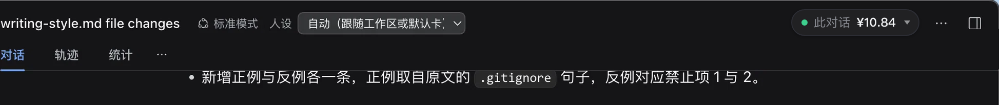

# DSH-plugins

DeepSeekHarness 自定义插件集合包，提升开发者体验。

## 【插件展示】

### @tjh/dsh-plugin-useage（对话花费）

标题行显示此对话总金额，点开看今日、总计与余额。

图 1：功能展示



图 2：弹窗展示


## 安装插件

仓库根 `.npmrc` 固定使用 `https://registry.npmjs.org/`。DSH 从 profile 目录安装插件，不读取该文件；安装前确认 profile 的 pnpm registry 能解析官方包。

```sh
dsh plugin --profile <profile> add @tjh/dsh-plugin-useage
```

也可以在插件管理器中搜索包名安装。

## 发布插件

```sh
pnpm release
```
