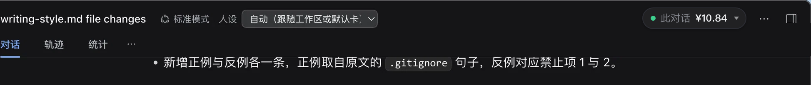
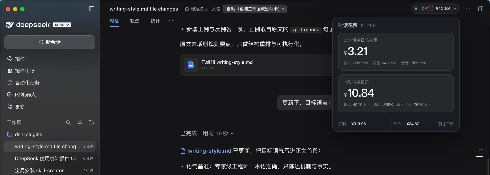

# @tjh/dsh-plugin-useage

标题行显示此对话总金额，点开看今日、总计与余额。

## 截图演示

图 1：功能展示



图 2：弹窗展示



胶囊来自真实页面截图，弹窗内数值为示意。

## 开发与验证环境

| 项 | 值 |
| --- | --- |
| DeepSeek Harness | `@deepseek-ai/dsh` **0.2.2-rc.5** |
| 安装形态 | Desktop 应用，代码位于 `/Applications/DeepSeek Harness.app/Contents/Resources/app.asar/dsh/` |
| 验证日期 | 2026-11-19 |
| 验证过的接口 | 会话投影注册 `ctx.sessionProjections`、`assistant/message` / `assistant/attempt` 的 usage、`request/header` 的 provider/model、`conversation.session.header.utilities` 槽、`ctx.remote.account.getBalance` |

DSH 升级后先比对该表，再按 `dsh-doc` 的升级指引复核投影与槽位契约。

## 安装

从 npm 安装：

```sh
dsh plugin --profile <profile> add @tjh/dsh-plugin-useage
```

也可以在插件管理器中搜索并安装 `@tjh/dsh-plugin-useage`。DSH profile 的 registry 必须能解析 npm 官方源；仓库根 `.npmrc` 只作用于本仓库命令，不作用于 profile。

本地开发时，在仓库根执行 `pnpm install`，再在插件管理器中安装本地目录 `plugins/useage`。

启用：在 profile 的 `cordis.patch.yml` 里加入：

```yaml
- insert:
    - id: useage
      name: '@tjh/dsh-plugin-useage'
      config:
        currency: CNY
        timezone: Asia/Shanghai
        showBalance: true
        prices: {}
```

## 配置

`prices` 的键是 `provider/model`，值是该路由下四个 token 桶的单价，单位「每百万 token」，币种由 `currency` 决定。

```yaml
config:
  currency: CNY
  timezone: Asia/Shanghai
  showBalance: true
  prices:
    deepseek/deepseek-v4-flash:
      input: 1
      output: 10
      cacheRead: 0.1
      cacheWrite: 1
```

- 内置 DeepSeek 官方标准价：`deepseek-flash`（输入 2 / 输出 8 / 缓存读 0.04）、`deepseek-v4-pro`、`deepseek-chat`、`deepseek-reasoner`；`prices` 里的同名条目覆盖内置值，带 `provider/` 前缀的键优先。
- 内置价是高峰时段价，低峰时段实际约为标准价一半，按标准价显示的金额会偏高；要精确到时段，把当时的单价写进 `prices`。
- 表里没有的模型：金额位显示 `—`，token 照常统计。
- 修改价格：投影视图按当前价格现算，重新启用插件即生效，不需要重放日志。
- `timezone` 决定「今日」的日界，默认 `Asia/Shanghai`。

## 行为

- token 与金额在每个 `assistant/message` 结算后更新一次；一个 turn 有多次模型调用就更新多次，不等整轮结束。
- 重试与失败调用按 DSH 的替换语义计数，不重复累加。
- 余额在展开弹窗时查询一次：查询中显示加载态，失败显示「查询失败」与重试按钮，余额行始终保留。
- 胶囊显示此对话累计金额；今日金额与 token 明细在弹窗内。弹窗始终展示两张卡，不做相同值合并。
- 「今日总花费」在每次展开时统计一次本机今天的全部会话（含子会话），数据来自会话日志按模型 token × 单价（含峰谷）换算，计算期间显示加载态。
- 没有上报 usage 的调用不计入 token 与金额。

## 限制

- 不做逐 token 实时估算。
- 不做多币种换算。
- 「今日总花费」只含本机会话；网页端与其他设备的消耗不计入，与平台用量页的全账号口径会有差异。
- 会话日志里缺少 usage 的调用不计入，卡片金额可能略低于平台账单。
- 胶囊固定在标题行右侧（`conversation.session.header.utilities`），不在标签行右端。
